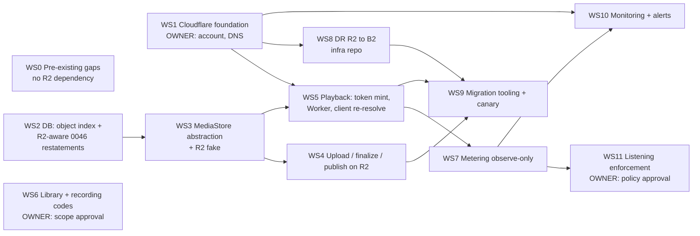
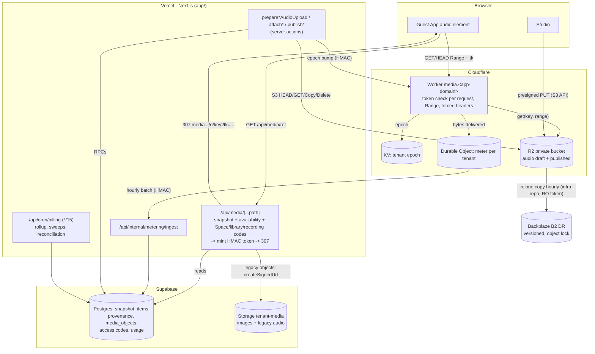

# 00 - Execution plan: audio on Cloudflare R2 (TASK 032.5)

Date 2026-10-10, revised 2026-10-11 (v2 execution pack below). **This is a plan. No code, migration, resource, DNS record or hosted query exists for any of it.** Migration numbers `0047+` are placeholders, and nothing is written.

Inputs:
- [01 Current architecture](./01-CURRENT-AUDIO-ARCHITECTURE.md)
- [02 Vendor research](./02-VENDOR-RESEARCH.md)
- [03 Cost model](./03-COST-MODEL.md)
- [04 Security, streaming, metering](./04-SECURITY-STREAMING-METERING.md)
- [05 Migration, DR, benchmark, monitoring](./05-MIGRATION-BENCHMARK-MONITORING.md)
- [Decision gate](./DECISION-GATE.md)

Markers: **[ESTIMATE]**, **[UNVERIFIED]**, **[OWNER]** (needs an owner decision or action).

---

## Execution pack v2 (2026-10-11): W0–W6

**This supersedes the WS0–WS11 table below for sequencing and approvals.** The WS sections stay as detailed design references.

The owner approved R2 **in principle** on 2026-10-11. **Implementation is NOT authorised.** Each workstream needs its listed approvals.

| v2 | Covers v1 | Status 2026-10-11 |
|---|---|---|
| **W0** Media security gap closure | WS0 | Safe fixes done locally (W0-1, W0-2 report, W0-3). Staging apply needs approval |
| **W1** Cloudflare infrastructure and POC | WS1, Phase J | POC plan ready (06-POC-PLAN.md). Waiting for POC approval |
| **W2** Upload and provenance integration | WS2, WS3, WS4 (upload half) | Designed |
| **W3** Publish and playback integration (+ **W3a** access codes) | WS4 (publish half), WS5, WS6 | Designed. W3a can ship before R2 |
| **W4** Listening-minute metering | WS7, WS10 (metering alerts), WS11 (later) | Designed (04 §F.7 v2: listening is kept separate from bandwidth) |
| **W5** Migration, backups and rollback | WS8, WS9 | Designed. Backup gaps found (GAP-INVESTIGATION §B) |
| **W6** Staging QA and Production readiness | §19–§27 | Designed |

### W0 — Media security gap closure (no R2 dependency)
- **Dependencies:** none.
- **Affected files (done):**
  - `app/src/lib/media/draftRefs.ts`
  - `app/src/app/(site)/configurator/retreat/actions.ts`
  - `app/src/app/(site)/configurator/retreat/flowAudioDeletion.test.ts`
  - `app/supabase/migrations/0047_media_bucket_limits.sql` and its rollback
  - `app/supabase/verification/orphan-media-report.sql`
  - `app/src/lib/spaceTypes/publishSpaceRegression.test.ts`
- **Affected files (planned, owner approval needed):**
  - Studio usage meter and browser pre-check: `retreat/audio-step.tsx:399`, `teach-studio-sections.tsx:1643`, Studio page props.
  - Orphan-prevention sweep: post-attach sweep of the item's own folder, objects older than 1 h.
- **Migration plan:** 0047 forward-only, a single `UPDATE storage.buckets`. The rollback restores NULLs. It is independent of the 0036–0046 billing chain. Apply order: Staging → (Production at the release gate, together with the TASK 032 billing migrations or separately).
- **Security requirements:**
  - Size and MIME are enforced by Storage for every writer, including the service role.
  - Draft cleanup never touches `published.*` or another tenant's paths (`isDraftMediaPathForTenant`).
- **Tests:**
  - flowAudioDeletion (4 tests);
  - migration-chain test;
  - local Storage API behaviour (415/413/200);
  - after the Staging apply: hosted real-storage tests plus a member upload of `text/html` → 415.
- **Acceptance:**
  - Staging bucket shows the limits;
  - the Studio Flow/Teach audio and image uploads still work (browser QA);
  - the orphan report shows 0 after deleting a Flow audio item.
- **Rollback:** 0047 rollback file; `git revert` for the code.
- **Owner approvals:**
  - **AW0-a:** apply 0047 to Staging and deploy the W0 code to Staging.
  - **AW0-b:** the legacy-Space content-check policy (keep legacy permissive, or add a decoder check for all Spaces).
  - **AW0-c:** the orphan-sweep retention (D7).
- **Destructive cleanup:** none needed today (0 orphans on Staging and Production, 2026-10-11). Any future cleanup is approval-gated and run-scoped.

### W1 — Cloudflare infrastructure and POC
- **Dependencies:** W0; owner approvals A1–A6 (DECISION-GATE v2).
- **Affected files:** new `infra/media-worker/` (Worker, `wrangler.toml` per environment, tests), and a POC-flagged token mint in `app/src/app/api/media/[...path]/route.ts`.
- **Migration plan:** none for the POC. Synthetic tenants use existing tables.
- **Security requirements:** 04 §D rows 1–20; the bucket is private; Staging-only credentials.
- **Tests:** 06-POC-PLAN.md §3 (48 rows).
- **Acceptance:** every P-SEC/P-TOK row passes; P-STR passes on all browsers including iOS; P-COST within budget.
- **Rollback:** POC flag off. Resources are torn down only on approval.
- **Approvals:** A1–A6.

### W2 — Upload and provenance integration
- **Dependencies:** a successful POC and owner approval for full implementation.
- **Affected files:**
  - `src/lib/media/{audioUpload.ts, path.ts, publish.ts, trustedMedia.server.ts, fingerprint.ts, audioDuration.ts}`
  - `src/lib/billing/audioFinalize.server.ts`
  - Flow/Teach attach actions
  - new `src/lib/media/store/{index.ts, supabaseStore.ts, r2Store.ts, r2Fake.test-util.ts}`
- **Migration plan:**
  - `media_objects` index plus `media_store_overrides`;
  - R2-aware restatements of the two 0046 `storage.objects` checks (04 §D.3);
  - each with a rollback file and a local rehearsal.
- **Security requirements:**
  - presigned PUT pinned to type and length;
  - server-side measurement from R2;
  - provenance written in the same transaction as the ref;
  - members never hold R2 credentials.
- **Tests:**
  - the store contract tests run against both implementations;
  - harness sections M/N/O/P re-run with R2 objects;
  - P-UPL rows.
- **Acceptance:** with both stores, the harness passes 242/242 plus the new checks.
- **Rollback:** the per-object store marker routes back to Supabase. Index tables stay.
- **Approvals:** full-implementation approval; D7 retention.

### W3 — Publish and playback integration (+ W3a access codes)
- **Dependencies:** W2. W3a has none beyond W0 and owner scope approval (D4).
- **Affected files:**
  - `/api/media` route;
  - `src/lib/media/cachePolicy.ts`;
  - `use-audio-player.ts` (re-resolve);
  - the Studio preview loaders;
  - Worker epoch endpoint.
  - W3a: new `src/lib/guestAccess/mediaGrants.ts`, guest code prompt UI, Studio controls, 7-locale strings.
- **Migration plan:** W3a adds `media_access_codes` plus 4 RPCs (04 §D.1/D.1b), with a rollback.
- **Security requirements:** short-lived tokens; epoch revocation; every configured code required; one rate budget shared per tenant plus a global ceiling.
- **Tests:** P-TOK and P-STR rows; the 8-combination code matrix; revocation; cross-tenant.
- **Acceptance:**
  - playback works on every browser;
  - revocation takes ≤ 60 s (R2) or ≤ the signed-URL TTL (Supabase);
  - codes are enforced on both stores.
- **Rollback:** a flag returns the redirect to Supabase signed URLs. The W3a migration rollback refuses if any codes exist, unless forced with a token.
- **Approvals:** D4/D4b (codes); full implementation (R2 playback).

### W4 — Listening-minute metering (observe-only)
- **Dependencies:** W3.
- **Affected files:**
  - Worker `/m` beacon endpoint and Queue consumer;
  - `use-audio-player.ts` beacon;
  - `/api/internal/metering/ingest`;
  - Billing/Admin usage views.
- **Migration plan:** `media_listen_tokens` (24 h TTL), `media_usage_hourly`, `media_usage_monthly`.
- **Security requirements:** no IP, UA, listener id or cross-Space id; only the nonce hash is stored, for 24 h; credited seconds are bounded (04 §F.7).
- **Tests:** P-MET rows; unit tests for the crediting bounds; a privacy schema test (no IP or UA columns).
- **Acceptance:** ±5% accuracy against ground truth on the browser matrix; bandwidth reported separately.
- **Rollback:** turn the beacon off. The data stays.
- **Approvals:** D5 (enforcement policy, which comes later), legal/privacy review. `ENFORCE_LISTENING` stays off.

### W5 — Migration, backups and rollback
- **Dependencies:** W2, W3, and backup hardening.
- **Affected files:**
  - infra repo `innerdwes_backup_infra`: the R2 → B2 workflow;
  - the existing workflow hardening (`--max-delete`, `rclone check`, alerts);
  - app migration tooling.
- **Migration plan:** 05 Phase I (inventory → copy → sha256 verify → per-object cutover → canary order with Lena and Return to Balance last). Supabase copies are retained for D7 days.
- **Security requirements:**
  - Object Lock or delayed deletion;
  - a CI key without delete rights;
  - an encrypted off-platform `pg_dump`.
- **Tests:** P-DR rows; a restore drill that measures RTO.
- **Acceptance:** 100% sha256 parity; restore drill passed; zero playback errors on canary Spaces for 7 days.
- **Rollback:** a per-object store marker back to Supabase (copies retained).
- **Approvals:** D3 (B2 settings and key rotation), D7, migration-window approval, and an explicit Production migration approval.

### W6 — Staging QA and Production readiness
- **Dependencies:** W1–W5.
- **Scope:**
  - full Staging regression (harness, journeys, Admin QA, guest QA, 7 locales, 7 viewports);
  - browser and device matrix;
  - cost check against 03 v2;
  - monitoring 70/85/95 (05 §K).
- **Production gate:** the §27 gates plus a **separate explicit owner approval** for each of: the Production migration, the Production deploy, the Production DNS record, and enabling metering. Production is never touched within the POC.

---

## Workstreams and dependencies (v1 detail; sequencing superseded by v2 above)

Workstreams with no arrow between them are parallel-safe: they touch disjoint files, or only a new file.

| WS | Scope | Depends on | Parallel-safe with |
|---|---|---|---|
| **WS0** | Pre-existing gaps that need fixing regardless of R2 (below) | none | everything |
| WS1 | Cloudflare account, Staging bucket, KV, DO, Worker skeleton, media subdomain DNS | **[OWNER]** account, DNS authorization, paid-resource approval | WS0, WS2, WS3, WS6 |
| WS2 | Migration 0048: `media_objects`, `media_store_overrides`, R2-aware restatements of the two 0046 checks | none (built and rehearsed locally) | WS0, WS1, WS6 |
| WS3 | `MediaStore` interface (Supabase and R2 implementations) used by upload, measure, copy, delete, list; R2 test fake alongside `fakeSupabase.test-util.ts` | WS2 (index contract) | WS1, WS6 |
| WS4 | Presigned PUT upload, HEAD finalize, R2 measurement, CopyObject publish, cleanups in both stores | WS2, WS3 | WS5 (different files except `path.ts` constants, so coordinate) |
| WS5 | Token minting in `/api/media` and the Studio loaders, the Worker, the epoch admin endpoint, `use-audio-player.ts` re-resolve | WS1, WS3 | WS4, WS6 |
| WS6 | Library and per-recording access codes, migration 0049 (works for both stores) | **[OWNER]** scope approval (D4) | WS1-WS5 (touches `/api/media` check order, so merge after WS5 or rebase) |
| WS7 | Byte accounting, DO accumulator, ingest route, migration 0050, Admin and Billing read-only meter | WS5 | WS8, WS9 |
| WS8 | R2 to B2 rclone, manifest, delayed purge, drills; verify the TASK 027 pipeline | WS1, **[OWNER]** infra-repo access | WS4-WS7 |
| WS9 | Inventory, copy, verify and cutover tooling; canary execution | WS4, WS5, WS8 | WS7, WS10 |
| WS10 | Alerts (05 Phase K) | WS1, WS7 | WS9 |
| WS11 | Organizer notices and the degrade step | WS7 plus one month of observe-only data, **[OWNER]** policy approval | - |

### Workstream 0 - pre-existing gaps (fix regardless of R2)

| # | Gap (evidence) | Fix | Notes |
|---|---|---|---|
| 0.1 | `tenant-media` has no `file_size_limit` or `allowed_mime_types` (01 §2, `0006_schedule_screen_and_storage.sql:23`) | Migration **0047**: set `file_size_limit = 104857600` (equal to `MAX_AUDIO_BYTES`, `audio.ts:31`) and `allowed_mime_types` to the audio types in `AUDIO_ALLOWED_TYPES` plus `image/webp`, `image/png`, `image/jpeg`. Images are re-encoded to WebP server-side; check whether legacy png/jpeg uploads still exist before narrowing **[verify]**. Rollback script restores NULLs | Affects member browser uploads only. Existing objects are untouched. Test with the real-stack Storage test (`realStack.0029.integration.test.ts`) |
| 0.2 | Unattached drafts are never swept (01 §19, §6.2) | Cron step: delete versioned `draft.*` audio objects older than 24 h that no `module_items.metadata.audioRef` references, per tenant, service role, chunked. In R2 also sweep `media_objects.state='pending'` older than 24 h | Must not touch a draft attached between list and delete. Re-check the reference under the per-tenant advisory lock, or skip anything newer than the grace period |
| 0.3 | Flow item deletion leaks draft audio (`retreat/actions.ts:1451-1482`, `saveModuleItemsGeneric` remove block about `:501-523` selects `id, image_ref` only) | Also select `metadata` and pass `metadata.audioRef` drafts to `removeDraftObjects`, mirroring Teach's `itemDraftRefs` (`teach/actions.ts:382`) | Add tests matching `teach/audioLifecycle.test.ts` |
| 0.4 | ~~No media DR~~ **Corrected 2026-10-11:** a Production Storage → B2 sync exists and is verified (GAP-INVESTIGATION §B). Remaining gaps: immutability, checksums, alerts, restore drill, off-platform DB dump | Harden the infra-repo workflow (W5). **[OWNER]** B2 console checks and key narrowing | No app code |
| 0.5 | PITR off (01 §23) | **[OWNER]** decide whether to enable PITR on Production (paid add-on; price not verified here) | Shortens the DB RPO from 24 h |

---

## 1. Architecture diagram

## 2. Current versus proposed

| Aspect | Current (01) | Proposed |
|---|---|---|
| Audio bytes | Supabase Storage `tenant-media` | R2 private bucket (images stay in Supabase) |
| Upload | Browser to Storage with member JWT, authorized by RLS (0006/0029/0039/0045) | Browser to R2 presigned PUT minted after the server's membership, writability and policy checks |
| Attach | `info()`, download, measure, hash (enforced only) | HEAD, then GET, measure, hash (**all** Spaces), RPC with index check |
| Publish | Storage `copy` (create-only), re-hash | R2 CopyObject (create-only), re-hash against sha256 provenance |
| Guest playback | 307 to a Supabase signed URL (60/180 s, unrevocable) | 307 to a Worker URL with a 10 min HMAC token, checked on every Range, epoch revocation, deadline cap |
| Access codes | Space code only | Space + optional library + optional recording codes (all configured layers required) |
| Listening | not metered | Worker byte accounting (observe-only first), soft enforcement behind a flag |
| DR | none in repo; PITR off | R2 to B2 hourly, versioned, object lock, drills |
| Cost at 100 Spaces x 80k min | about $496/month (03) | about $5.37/month (03) |

## 3. Affected-file inventory

The full list is in 01 §5. Summary by workstream:

- **WS3/WS4 upload and publish:** `src/lib/media/{audioUpload,audio,path,publish,publishedCleanup,draftCleanup,tenantCleanup,trustedMedia.server,fingerprint,draftAuthorization}.ts`; `src/lib/billing/audioFinalize.server.ts`; `configurator/teach/actions.ts` (:381-997); `configurator/retreat/actions.ts` (:484-523, :1451-1700, :2006-2237); `teach-studio-sections.tsx` (:1638-1680); `teach-studio.tsx` (:493-501); `audio-step.tsx` (:394-438); `retreat/lifecycleActions.ts` (:193, :304, :339); `src/app/(site)/(auth)/actions.ts:232`; `src/lib/billing/spaceDeletion.ts`.
- **WS5 playback:** `src/app/api/media/[...path]/route.ts`; `src/lib/media/cachePolicy.ts`; `src/components/shared/use-audio-player.ts`; `src/components/guest/{audio-screen,published-space-screen}.tsx`; `src/components/teach/teach-library.tsx`; `src/lib/teach/guestData.ts`; the Studio loaders `teach/[tenantId]/page.tsx:96` and `retreat/[tenantId]/page.tsx:63`; a new `workers/media-gateway/` (new top-level folder, its own `wrangler.toml`, outside `app/`, **[decide location]**).
- **WS6 codes:** `/api/media` route; `src/lib/guestAccess/*` (reuse `cookieToken.ts`, `ipHmac.ts`); new Studio code UI in Teach and Flow; new guest prompt UI; 7 locales.
- **WS7 metering:** the Worker; new `src/app/api/internal/metering/ingest/route.ts`; `src/lib/billing/{audioQuota,entitlements,billingPageModel,customerView}.ts`; `lifecycleJob.ts` (rollup step).
- **SQL:** new 0047-0050; restated `billing_audio_attach_verified` and `billing_guard_subscription_enforcement` (0046 heads); verification and rollback scripts under `supabase/verification/`; `rehearse-billing-rollback.sh`.
- **Tests and docs:** 01 §5 "Tests" and "Docs" lists.

## 4. Database changes (placeholders, nothing written)

| Migration | Contents |
|---|---|
| **0047_tenant_media_bucket_limits** (WS0) | `storage.buckets` update for `tenant-media`: `file_size_limit`, `allowed_mime_types`. Rollback restores NULL |
| **0048_media_object_index** (WS2) | `media_objects(object_key text pk, tenant_id uuid fk cascade, store text check in ('supabase','r2'), kind text check in ('draft','published'), item_id uuid null, size_bytes bigint, sha256 text, etag text, content_type text, state text check in ('pending','present','deleted','unindexed'), supabase_retained bool, created_at, finalized_at, deleted_at, migrated_at)`, with an index on `(tenant_id, state)`. `media_store_overrides(tenant_id pk, store, set_by, set_at, reason)`. RLS on, no policies, REVOKE from anon/authenticated. RPCs (service_role only): `media_object_register_pending`, `media_object_mark_present`, `media_object_mark_deleted`, `media_object_set_store_for_tenant`. **Restate** `billing_audio_attach_verified` (adds the `media_objects` sibling check, keeps the `storage.objects` probe) and `billing_guard_subscription_enforcement` (adds the `media_objects` clause). Fingerprints recorded per `MIGRATION-RECOVERY.md` |
| **0049_media_access_codes** (WS6) | `media_access_codes` + RPCs `set_/disable_/verify_media_access_code`, `get_media_access_requirements` (04 §D.1). Reuses `check_and_record_guest_attempt` with no change |
| **0050_media_usage** (WS7) | `media_usage_hourly`, `media_usage_monthly`, `media_mint_counters(tenant_id, minute, count)`, RPCs `media_usage_ingest(batch jsonb)`, `media_usage_rollup()`, `media_mint_check(tenant)`, owner read RPC `space_listening_usage(tenant, month)` (04 §F.5) |

Each migration needs a forward script, a rollback script under `supabase/verification/`, a step in the local rehearsal, and Staging verification before Production (`MIGRATION-RECOVERY.md`, `ROLLBACK-REHEARSAL.md`).

## 5. Migration dependencies

- 0047 is independent.
- 0048 must reach Production **before** any Production object is written to R2. Otherwise the 0046 probes are blind (04 §D.3).
- 0049 is independent of 0048. The `/api/media` code that reads it must deploy after 0049 is live (fail closed if the RPC is missing: treat that as "required, locked" so codes cannot be bypassed during deploy).
- 0050 must precede `METERING_ENABLED=on`.
- Chain order for the Production release: 0047, then 0048, then (0049, 0050 in either order). Rollback runs in reverse. 0048 can only be rolled back while no tenant has `store='r2'` objects that are `present` without `supabase_retained`.

## 6. Cloudflare configuration [OWNER creates; nothing created by this task]

Per environment (`staging`, `production`):

| Resource | Setting |
|---|---|
| R2 bucket | `innerdwes-audio-<env>`, Standard class, `r2.dev` **disallowed**, **no custom domain**. Bucket CORS (for presigned PUT only): AllowedOrigins = the Studio origin for that env, Methods PUT, Headers `content-type`, MaxAge 600 |
| Worker | `media-gateway-<env>`, Custom Domain `media[-staging].<app-domain>`, bindings `AUDIO_BUCKET` (R2), `EPOCH_KV` (KV), `METER` (DO class), secrets (§7). Observability: head sampling 0 or status-only logging |
| KV namespace | `media-epoch-<env>` |
| Durable Object | class `TenantMeter` (SQLite storage) |
| Zone | Cache Rule "bypass cache" for the media hostname. WAF rate limit on the media hostname **[optional, plan-dependent]** |
| Account | Budget alerts at 70/85/95% of the owner budget (02 §K) |
| API tokens | app R2 R/W (one bucket), DR R2 RO (one bucket), CI deploy token (Workers + KV edit) |

## 7. Environment variables (names only)

- **Vercel (server only, per environment):** `R2_ACCOUNT_ID`, `R2_S3_ENDPOINT`, `R2_ACCESS_KEY_ID`, `R2_SECRET_ACCESS_KEY`, `R2_AUDIO_BUCKET`, `MEDIA_WORKER_ORIGIN`, `MEDIA_TOKEN_KEYS`, `MEDIA_TOKEN_TTL_SECONDS`, `MEDIA_WORKER_ADMIN_KEY`, `METERING_INGEST_KEY`, `MEDIA_STORE_DEFAULT`, `MEDIA_DUAL_READ`, `METERING_ENABLED`, `ENFORCE_LISTENING`.
- **Existing, unchanged:** `NEXT_PUBLIC_SUPABASE_URL`, `NEXT_PUBLIC_SUPABASE_PUBLISHABLE_KEY`, `SUPABASE_SECRET_KEY`, `GUEST_ACCESS_TOKEN_SECRET`, `GUEST_ACCESS_IP_HMAC_SECRET`.
- **Worker:**
  - secrets `MEDIA_TOKEN_KEYS`, `MEDIA_WORKER_ADMIN_KEY`, `METERING_INGEST_KEY`
  - vars `ALLOWED_ORIGINS`, `INGEST_URL`, `ENVIRONMENT`
  - bindings `AUDIO_BUCKET`, `EPOCH_KV`, `METER`
- **Infra repo (DR):** `R2_DR_ACCESS_KEY_ID`, `R2_DR_SECRET_ACCESS_KEY`, `B2_DR_KEY_ID`, `B2_DR_APPLICATION_KEY`, `B2_DR_BUCKET`.
- **No `NEXT_PUBLIC_*` R2 variable.** Preview, `staging` and Production values are distinct, and Preview must never receive Production values (CLAUDE.md).

## 8. Key and security management

04 §D.4 has the credential table. In short:
- one-bucket, least-privilege R2 tokens
- HMAC keys with `kid` and two active keys, rotated every 90 days or on suspicion
- the Worker never holds the Supabase secret key (it ingests through an HMAC-authenticated Next.js route)
- a rotation runbook rehearsed on Staging before Production
- an alert when a rotation is overdue (05 Phase K)

## 9. Storage layout

- R2 keys are **identical** to today's: `{tenant}/{teachAudioFile|audioFile}/{itemId}/{uploadId}/{draft|published}.<ext>` (`path.ts:106`). One bucket per environment. No key change, so no SQL regex or snapshot change (01 §4.1).
- Custom metadata on R2 objects: `x-amz-meta-sha256` (convenience only, never trusted for integrity) and `x-amz-meta-tenant`.
- B2 layout mirrors R2 under `objects/`, with `manifests/YYYY-MM-DD.jsonl` alongside.

## 10. Upload pipeline

1. `prepare*AudioUpload`:
   - checks the client-claimed MIME and size, membership and `space_studio_writable`; on a paid Space it applies the draft-audio-only policy
   - mints the key (`newUploadId()`) and registers `media_objects` as `pending`
   - returns a **presigned PUT** for that key: TTL 15 min, `Content-Type` signed, `If-None-Match: *` signed if supported **[UNVERIFIED]**, size cap via finalize
   - returns the Supabase path instead when the tenant's store is `supabase`
2. The browser `fetch(PUT)` replaces `storage.upload` in `audioUpload.ts:15`. Progress uses XHR if the UI needs it.
3. `attach*Audio` (server finalize):
   - HEAD the object; `size ≤ MAX_AUDIO_BYTES`, and the Content-Type must map to the key's extension, otherwise delete it and refuse
   - HEAD the published sibling; if it exists, refuse `AUDIO_REUPLOAD`
   - GET the bytes, then `deriveAudioDuration` and sha256 (`measureStoredAudio`)
   - enforced Spaces: `billing_audio_attach_verified` (0048 restatement). Legacy and exempt Spaces: existing metadata write, plus the recommended measured duration
   - `media_object_mark_present`, then delete the replaced draft
4. **Memory risk** (01 §6.9): 100 MB buffered per attach. A streaming hash plus a ranged parse is a later optimization (not required). Keep the publish concurrency at 2.

## 11. Playback

04 Phase E. `/api/media` is unchanged up to authorization. It then checks the new codes, looks up `media_objects`, and for `r2` mints the token (TTL `min(10 min, next access deadline)`, epoch from DB-mirrored state). It answers 307 with `private, no-store`. The Worker validates on every request and serves 200/206/304/416 with forced headers. The client re-resolves on error or stall and pre-emptively after `TTL - 90 s`. Studio previews use the same token, kind `draft`.

## 12. Publish

- `copyDraftAudioToPublished` becomes R2 `CopyObject(draft, published)`, create-only (`If-None-Match: *` **[UNVERIFIED]**, else HEAD and copy under the per-tenant lock). Then GET the published copy, compute sha256 and compare with provenance (as `publish.ts:306`). Register `media_objects` `published`/`present`.
- **Multipart ETag caveat:** R2 and S3 multipart ETags are not content MD5s, and CopyObject may produce an ETag different from the source's. **Never compare ETags across objects or treat an ETag as a hash.** sha256 provenance is the integrity anchor. The skip in `publish.ts:321-323` stays valid only as "this exact key still reports the ETag and size we recorded after hashing it", and that holds because keys are create-only and only server credentials write.
- `publish_space()` and `build_teach_payload` are unchanged, because keys are unchanged.
- The post-publish sweep resolves the store per key.

## 13. Entitlement enforcement

The library and per-recording limits are unchanged (0043/0046 triggers, `audioQuota.ts`). The only change is the source of bytes for measurement. Listening is §14 and WS11. Commercial availability is unchanged (`resolveGuestAccessDetailed`), plus the deadline-capped token TTL and the epoch for revocation.

## 14. Metering

> **v2 (2026-10-11):** listening usage and delivered bandwidth are separate metrics. The design has no Durable Object: a beacon goes through the Queue, and bandwidth goes to Analytics Engine. See 04 §F.7, which supersedes the text below where they conflict.

04 Phase F, approach 6: Worker byte accounting with per-nonce union dedupe, a DO per tenant, hourly flush to `media_usage_hourly`, and rollup in the billing cron. An optional played-seconds beacon serves as cross-check, and R2 analytics as the monthly cross-check. No identity is stored. **Observe-only** until the V7-style go decision.

## 15. Cache strategy

- **No edge caching of authorized audio** (04 req. 18): Worker `private, no-store`, a zone Cache Rule bypass, no Cache API.
- The `/api/media` redirect for R2 objects is `private, no-store` in every mode. The public `max-age=60` remains for **Supabase-served images only** (`cachePolicy.ts` unchanged for images).
- Browser variant `private, max-age=<token remaining>` is a benchmark option only (04 §E.1).

## 16. Disaster recovery

05 Phase H: hourly R2 to B2 `rclone copy` with an RO token, versioning, governance-mode Object Lock for 30 days, SSE-B2, a sha256 manifest, deletion purge delayed 30 days, and quarterly drills. Interim: Supabase to B2 (WS0.4). Verify the TASK 027 infra pipeline **[OWNER]**.

## 17. Migration algorithm

05 Phase I, 18 steps: inventory, classify, batches, copy, sha256 read-back, size, duration, index, permission checks, dual-read, live verify, cutover, rollback, orphans, retention, Supabase deletion, DR check, performance check. Canary order is in 05 §I.1: synthetic first, **Return to Balance and Lena Teach last and separately**.

## 18. Rollback

| Layer | Rollback |
|---|---|
| Tenant read path | Flip `media_objects.store` back to `supabase` for the tenant (one transaction) and bump the epoch. Instant while Supabase copies are retained |
| New uploads | `media_store_overrides` set to `supabase`. R2-only uploads made since cutover are copied back (verified) before the flip |
| App code | Flags off (`MEDIA_STORE_DEFAULT=supabase`, `METERING_ENABLED=false`, `ENFORCE_LISTENING=false`). Code paths for Supabase are kept until all tenants are past step 16 |
| Worker | Redeploy the previous version (`wrangler rollback`). Failure mode: 404, then the client re-resolves; if `/api/media` is also flipped to Supabase, playback recovers |
| DB | Rollback scripts 0050, then 0049, then 0048, then 0047 (each rehearsed). 0048 rollback is allowed only under the §5 condition |
| Data | B2 restore (05 §H.1) |

## 19. Test matrix

| Area | Unit | Integration (fakes) | SQL rehearsal (local DB) | Staging |
|---|---|---|---|---|
| Token sign/verify, kid rotation, expiry, key/tenant/kind mismatch, epoch | yes (fuzzed parsing) | Worker tests (Miniflare/vitest-pool-workers **[tooling choice]**) | - | yes |
| Range parsing: 0-1, a-, -n, multi, 416, If-Range, HEAD, 304 | yes | Worker | - | browser + curl |
| Forced headers, nosniff, no Set-Cookie, no-store | yes | Worker | - | curl |
| `/api/media` order: snapshot, field, draft, availability, Space, library, recording codes; uniform 404 | yes | `route.test.ts` extended | - | yes |
| Access codes: both required, version bump, shared attempt budget, non-member requirements read refused | yes | yes | 0049 checks | yes |
| Upload: presigned scope, wrong content-type 403, oversize deleted at finalize, pending sweep | yes | R2 fake | - | yes |
| Attach/publish: sibling refusal (server + index), sha256 mismatch, cross-store refusal | yes | R2 fake | 0048 restatement checks (planted sibling via index row; fresh-enforcement with `media_objects` rows, incl. `pending`/`unindexed`) | `billing-db-verify.mjs` new section |
| Deletion: Space delete and Replace across both stores fail closed | yes | yes | - | yes |
| WS0: bucket limits, Flow draft-audio removal, orphan sweep | yes | yes | 0047 | real-stack Storage test |
| Metering: union dedupe, abort counts delivered only, flush idempotency, mint ceiling, no IP/UA in tables, no request-data logging | yes | DO tests | 0050 | ground-truth scenarios |
| Migration: checksum/size/duration mismatch paths, rollback flip, dual-read fallback | yes | fakes | - | canary 1-2 |
| Regression | the existing suites in 01 §5 "Tests" stay green | | | |

## 20. Browser QA matrix (real devices; nothing tested yet)

Each cell: play from 0, seek 50% and 90%, pause 12 min then resume (beyond TTL), background 5 min, lock screen 15 min (mobile), network drop for 30 s, two tabs, Space code / library code / recording code prompts, and revocation mid-session (epoch bump means the next range fails and the UI shows an error, not a hang).

| | MP3 | M4A faststart | M4A moov-at-end | WAV | OGG |
|---|---|---|---|---|---|
| Chrome desktop (Win/macOS) | x | x | x | x | x |
| Firefox desktop | x | x | x | x | x |
| Safari macOS | x | x | x | x | n/a **[Safari OGG support varies]** |
| Edge desktop | x | x | - | - | - |
| iOS Safari (current, current − 1) | x | x | x | x | n/a |
| iOS in-app WebView (Instagram/WhatsApp links) | x | x | - | - | - |
| Android Chrome | x | x | x | x | x |
| Android Samsung Internet | x | x | - | - | - |

## 21. Benchmarks

05 Phase J: paired Supabase and Worker runs on Staging, with thresholds for TTFB, time to play, seek, rebuffer, long-pause resume, CPU, error rate, revocation latency, metering accuracy, pipeline lag and measured cost. **No paid resource without owner approval.**

## 22. Cost model summary (03 v2, revised 2026-10-11; prices VERIFIED, workload ESTIMATE)

The v1 table here, ending in "$74.90 at 2,000 Spaces", is **withdrawn**. It left out the metering infrastructure.

| Spaces | Supabase uncached (Base, 80k min) | R2 Design B, Base | R2 Design B, Low / High |
|---|---|---|---|
| 10 | $32 | $5.00 | $5.00 / $5.42 |
| 100 | $522 | $7.58 | $5.18 / $53.97 |
| 1,000 | $5,426 | $110.94 | $10.99 / $695.61 |
| 2,000 | $10,876 | $239.19 | $17.91 / $1,408.54 |

- These are estimates for comparison, not forecasts. The POC measures the real request density (P-COST rows).
- Design A (a Durable Object per beacon, conservative duration) costs about $810 at Base with 2,000 Spaces. Design B (Queues plus Analytics Engine) is recommended.
- The $5 add-on loses money on Supabase and is viable on R2 (03 v2).

## 23. Monitoring

05 Phase K:
- 70/85/95% alerts on Cloudflare spend (native), R2/Workers/DO usage (custom), Supabase (custom), B2 (native 75/100 plus custom), and per-tenant listening (custom)
- the immediate-alert list, covering exposure drift, unindexed objects, checksum mismatches, token-failure spikes, ingest lag and DR failures
- **[OWNER]** alert delivery channel

## 24. Deployment order

1. WS0: 0047 and code fixes to Staging and then Production under their own release gate. B2 interim DR.
2. 0048 locally (rehearsal), then Staging. App code with the `MediaStore` abstraction and `MEDIA_STORE_DEFAULT=supabase` deployed. No behaviour change.
3. Cloudflare Staging resources **[OWNER]**, Worker deploy (staging), Staging env vars.
4. Staging: synthetic tenant override to `r2`; WS4/WS5 verified; benchmark (Phase J); browser matrix.
5. 0049 (codes) to Staging; WS6 verified (independent timing).
6. 0050 to Staging, then `METERING_ENABLED=true` on Staging; ground-truth runs.
7. R2 to B2 DR on Staging; first restore drill.
8. Production release gate (§27): 0048, then 0049/0050 to Production, then app deploy (flags off), Cloudflare Production resources, then the Worker.
9. Production canary steps 3-8 (05 §I.1), each with an owner go.
10. Production `METERING_ENABLED=true` (observe-only) for at least one calendar month.
11. WS11 enforcement only after an explicit owner policy approval.

**Pushing `main` deploys Production** (project memory). Every Production step needs its task's release gate, and the R2 work must stay on a feature branch until then.

## 25. Feature flags

| Flag | Values | Scope | Default |
|---|---|---|---|
| `MEDIA_STORE` | `supabase` \| `r2` | env default `MEDIA_STORE_DEFAULT`, per-tenant override in `media_store_overrides` (DB; flags cannot be per tenant in env) | `supabase` |
| `MEDIA_DUAL_READ` | on/off | env, read per tenant during migration | off |
| `METERING_ENABLED` | true/false | env | false |
| `ENFORCE_LISTENING` | true/false | env, plus per-tenant exemption (exempt Spaces are never enforced) | false |
| `MEDIA_TOKEN_TTL_SECONDS` | int | env | 600 |

## 26. Staging acceptance criteria

- All 20 requirements (04 Phase D) shown by a test or a recorded Staging check, including requirements 6-8 if WS6 is approved.
- Phase J thresholds met on the browser matrix (§20), including iOS lock screen, or that case explicitly accepted with a measured error figure.
- 0048 restatements proven on Staging: a planted published sibling (index row) is refused, and fresh enforcement is refused with only R2 objects or `pending` rows.
- Migration steps 1-18 executed for the synthetic tenant, including a rollback flip and a re-cutover.
- Metering within ±5% per scenario. Dedupe proven. No IP, UA or nonce in any Supabase table. A no-logging test passes.
- DR drill: one tenant prefix restored from B2 with 100% sha256 match. RTO recorded.
- Revocation: deadline cap at 0 s, epoch bump at p95 ≤ 60 s.
- The existing test suites, typegen, tsc, lint and build are green (CLAUDE.md engineering rules).

## 27. Production release gates

- Staging acceptance (§26) signed off by the owner.
- Migration fingerprints recorded and rollback rehearsed for 0047-0050 (`MIGRATION-RECOVERY.md` process).
- Production Cloudflare resources verified: bucket private, `r2.dev` disallowed, no custom domain on the bucket, Worker secrets set, Production keys distinct from Staging.
- Budget alerts configured. B2 DR running for Production with a verified first manifest.
- Canary plan (05 §I.1) approved per step. Lena Teach and Return to Balance have dual-read and retained Supabase copies.
- The authorizing task explicitly names the `main` push and Production deploy (CLAUDE.md).
- No Stripe or payment change is involved. The add-on upsell copy stays hidden until an add-on purchase task exists.

## 28. Operational handover

Runbooks to write (future), each rehearsed on Staging:
1. Key rotation (R2 tokens, HMAC `kid`).
2. Tenant rollback flip.
3. Epoch kill switch (per tenant and global).
4. DR restore (tenant and full).
5. Reconciliation alert triage (unindexed or missing objects).
6. Metering ingest backlog.
7. Cloudflare incident: fall back to Supabase if objects are retained, otherwise an outage notice.
8. Monthly cost review against 03.

Also update `OPERATIONS.md`, `ENVIRONMENT.md`, `EXTERNAL-SETUP-CHECKLIST.md`, `LAUNCH-GATES.md`, `ENTITLEMENTS.md` (listening status) and `LIFECYCLE.md` (retention).

## 29. Known risks

| # | Risk | Mitigation |
|---|---|---|
| 1 | Long-pause or lock-screen playback on iOS fails after token expiry | Measure TTL variants; longer audio TTL; epoch covers revocation |
| 2 | KV propagation slower than 60 s **[UNVERIFIED]** | Deadline cap for time-based states; measured in Phase J; fail-closed choice |
| 3 | Index drift (an R2 write outside the app) | Only 3 credential holders; nightly reconciliation; `unindexed` counts as present |
| 4 | Metering inflation by real downloads (public Spaces) | Mint ceiling, suspect bucket, observe-only, soft enforcement, Admin override |
| 5 | Metering undercount (offline, iOS background) | Accepted; beacon and analytics cross-checks |
| 6 | Presigned PUT cannot cap size **[UNVERIFIED]** | Finalize HEAD and delete; pending sweep; Worker-proxied upload not used (100 MB zone body limit, 02 §E) |
| 7 | `If-None-Match` on R2 PUT/Copy unsupported **[UNVERIFIED]** | HEAD then write under the advisory lock; random uploadId keys |
| 8 | Safari re-requests the original URL per range (Vercel cost) | Measure; JSON resolve alternative |
| 9 | Vendor dependency on Cloudflare added to the playback path | Supabase fallback while retained; B2 copy |
| 10 | 100 MB buffered measurement in serverless (01 §6.9) | Concurrency 2; later streaming parse |
| 11 | Dual-store complexity in cleanup and deletion | Store resolved per key; fail closed; tests across both stores |
| 12 | Access-code feature scope creep (UI in 7 locales) | Separate WS6 with its own approval |
| 13 | DB RPO 24 h (PITR off) versus media RPO 1 h | WS0.5 owner decision |
| 14 | TASK 027 B2 pipeline state unknown and still holding credentials | Owner verification; rotate or revoke |

## 30. Final recommendation

Proceed to **implementation review** of this plan, in this order:
1. **WS0 now** (independent, closes real gaps).
2. **WS2 + WS3** (no external dependency; makes the code store-agnostic with Supabase as default).
3. **WS1** once the owner has a Cloudflare account and media subdomain DNS, then **WS4/WS5** on Staging and the **Phase J benchmark**.
4. **WS8 DR** before any Production object lands in R2.
5. **WS9** canary with Lena Teach and Return to Balance last.
6. **WS7 metering observe-only**.
7. **WS11 enforcement** only after a month of data and an owner policy decision.
8. **WS6 access codes** as a separately approved product feature, at any point.

The cost case is decisive at every scale beyond about 10 Spaces (03). The security posture is stronger than today on revocation, per-range authorization and Content-Type control (04). The residual risks (29) are bounded and monitored.
